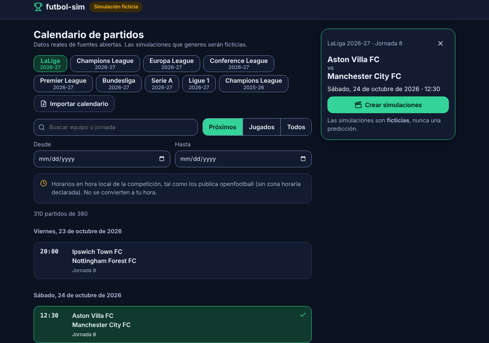
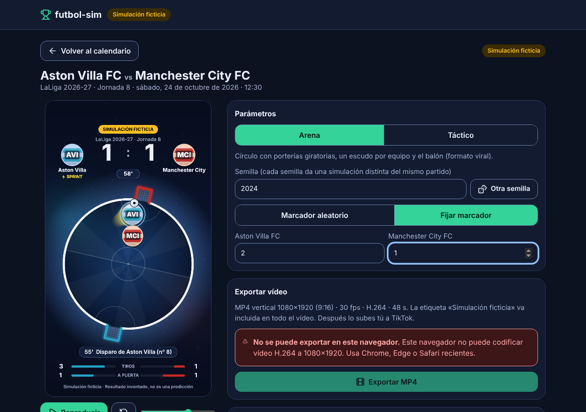
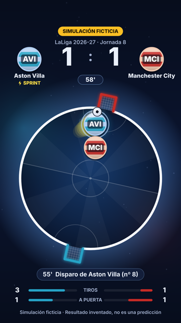
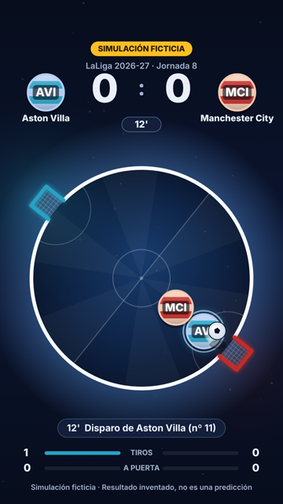
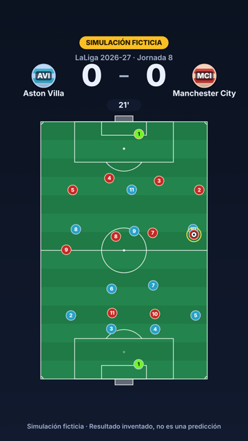

# futbol-sim

Aplicación web **100 % en el navegador** (sin backend, sin cuentas, coste 0 €) que:

1. muestra un **calendario de partidos reales** (LaLiga, Premier, Bundesliga, Serie A, Ligue 1, Champions League 2026-27 y 2025-26; Europa League y
   Conference League 2026-27 preparadas para importar),
2. permite elegir un partido,
3. genera **simulaciones 2D ficticias** con jugadas coherentes con el marcador (que puedes fijar o dejar aleatorio),
4. permite generar **varias simulaciones distintas** del mismo partido (cada semilla da un partido diferente),
5. exporta cada una como **MP4 vertical 9:16 (1080×1920, 30 fps)** listo para TikTok,
6. permite descargar los vídeos uno a uno o en **ZIP** (la publicación en TikTok es manual).

> La app indica siempre que las simulaciones son **ficticias** (etiqueta «Simulación ficticia» en la interfaz, metadatos del MP4 y LEEME del ZIP). Por decisión del usuario, el vídeo
> muestra en su cabecera la competición, fase y jornada, no ese rótulo. Los partidos (equipos, fechas) son reales; los resultados y las jugadas son inventados. Nunca son una predicción.

| Calendario real | Estudio de simulación |
| --- | --- |
|  |  |

El estudio de la captura se hizo en un navegador sin codificador H.264, por eso muestra el aviso de exportación; en Chrome, Edge o Safari recientes el botón está activo.

| Estilo Arena (por defecto) | Arena en juego | Estilo táctico (22 jugadores) |
| --- | --- | --- |
|  |  |  |

## Cómo se usa
1. **Calendario**: elige competición en la tira de tarjetas (desliza en el móvil), filtra por fecha («Próximos/Jugados/Todos»), busca un equipo y pulsa un partido → *Crear simulaciones*.
2. **Estudio**: reproduce la vista previa, cambia el estilo (*Arena* o *Táctico*), el **ritmo** (*rápido* por defecto, ~26 s; *normal*, ~50 s), la semilla («Otra semilla») o fija el marcador (0–9 por equipo). En *Escudos* puedes subir el escudo de cada equipo.
3. **Exportar MP4**: un vídeo con los parámetros actuales. **Generar varias simulaciones**: de 1 a 10 vídeos con semillas distintas, con progreso, cancelar,
   reintentar y *Descargar todo (ZIP)*.
4. Cuando descargas un vídeo (suelto o en ZIP) la tarjeta de ese partido se pone **verde** con «Hecho» en el calendario (se recuerda en tu navegador). Los partidos que ya hiciste por tu cuenta los marcas a mano con el círculo de la esquina de cada tarjeta (otra pulsación lo quita).
4. Sube el vídeo a TikTok tú mismo.

### Personalizar el vídeo
En el estudio, panel **Personalizar el vídeo** (se guarda en tu navegador y vale para la vista previa, la exportación y los lotes):
- **Colores de la arena** (Noche, Neón, Césped, Fuego) y **rebotes del balón** en las paredes (sin rebotes, pocos, normal, muchos). El balón rebota en el aro con la ley de reflexión, deja un destello en la pared y los escudos lo persiguen.
- **Qué se muestra**: estadísticas, último suceso y estela del balón.
- **Textos propios**: texto gancho bajo la competición («¿Quién gana? Comenta tu marcador»), marca de agua con tu usuario y texto del gol.

### Ritmo y escudos
- **Ritmo rápido (por defecto)**: arranque inmediato (intro de 1 s), jugadas comprimidas para que el total sea ~26 s y descanso/final cortos: el vídeo dura **26 s** (hasta 4-3; con 10 goles o más puede llegar a ~30–35 s) en vez de 35–65 s, para que el vídeo se vea entero.
  Con la misma semilla el partido es **idéntico** (mismos sucesos, minutos y marcador) en ambos ritmos; sólo cambia el tiempo.
- **Escudos**: por defecto cada equipo lleva un escudo genérico con sus colores. Puedes subir el de cada equipo (PNG, JPG o WebP, hasta 3 MB; se reduce a 256 px y se guarda sólo en tu
  navegador). Aparece en la vista previa y en los vídeos exportados. La app **no incluye escudos oficiales** (son marcas registradas): súbelos sólo si tienes derecho a usarlos.

### Competiciones
- **LaLiga, Premier, Bundesliga, Serie A y Ligue 1 (2026-27)**: datos abiertos de [openfootball](https://github.com/openfootball/football.json) (sin clave).
  Los horarios están en **hora local de la competición, sin zona horaria declarada**; la app no los convierte (ya no lo muestra como aviso en pantalla). Muchos partidos aún no tienen hora.
- **Champions League 2026-27**: fase de liga (144 partidos) incluida desde el Excel aportado (`public/data/champions-league-2026-27.xlsx`). Faltan las eliminatorias.
- **Champions League 2025-26**: temporada anterior (finalizada) de openfootball.
- **Europa League y Conference League 2026-27**: ninguna fuente libre las publica aún. Pulsa su pestaña → *Importar calendario* y sube un Excel con las columnas
  `Jornada · Fecha · Hora · Equipo Local · Equipo Visitante` (como el de la Champions), o un JSON/TXT (openfootball, football-data.org o fixturedownload.com).
  Se guarda sólo en tu navegador. Otros orígenes: ver [docs/football-data-org.md](docs/football-data-org.md) (no activado).

## Instalar en el móvil y actualizaciones
- **Añadir a la pantalla de inicio** (Safari: Compartir → «Añadir a pantalla de inicio»; Chrome: menú → «Instalar app» o «Añadir a pantalla de inicio»): se abre como una app, con su icono.
- **Se actualiza sola**: al abrirla, al volver a ella, al recuperar la conexión y cada 5 minutos comprueba `version.json`; si hay versión nueva se recarga sola. Si estás exportando, espera a que termine.

## Requisitos
- Node.js ≥ 22 y npm ≥ 10 para desarrollar.
- Para **exportar vídeo**: un navegador con WebCodecs que codifique **H.264** (Chrome, Edge o Safari recientes). Si no, la app lo explica y desactiva la exportación.
  El vídeo sale **sin audio** (puedes añadir sonido al publicarlo en TikTok).

## Comandos
```bash
npm ci                # instala las dependencias exactas
npm run dev           # servidor de desarrollo
npm run ci            # typecheck + lint + tests unitarios + build (obligatorio antes de cada commit)
npm run test:e2e      # e2e con Playwright (Chromium): calendario, estudio, accesibilidad (axe), subruta y exportaciones reales (~8 min)
npm run verify:export # exporta un MP4 en Chromium y lo valida con ffprobe/ffmpeg (deben estar instalados)
npm run bench         # rendimiento del dibujado (BENCH_EXPORT=1 añade la medición de memoria en exportaciones)
```

## Documentación
- [ARCHITECTURE.md](ARCHITECTURE.md): diseño (datos, motor, render, exportación, lotes, calidad).
- [TASKS.md](TASKS.md): qué está hecho y **probado**, qué queda **pendiente de verificar** y límites conocidos.
- [CLAUDE.md](CLAUDE.md): reglas permanentes del proyecto.
- [docs/DESPLIEGUE.md](docs/DESPLIEGUE.md): publicación en GitHub Pages (preparada, **sin desplegar**).
- [docs/football-data-org.md](docs/football-data-org.md): cómo enchufar football-data.org (no activado).

## Calidad (resumen medido)
- 125+ tests unitarios (motor determinista, coherencia marcador/goles, datos reales, cola de lotes, ZIP, reglas del proyecto) y e2e en Chromium.
- Accesibilidad: axe (WCAG 2.x A/AA, incluido contraste) sin violaciones en calendario, diálogo y estudio, en escritorio y móvil.
- Exportación de ~52 s de vídeo en ≈ 41 s en un Chromium sin GPU; el montón de JS vuelve a su nivel tras cada exportación (sin fugas).
